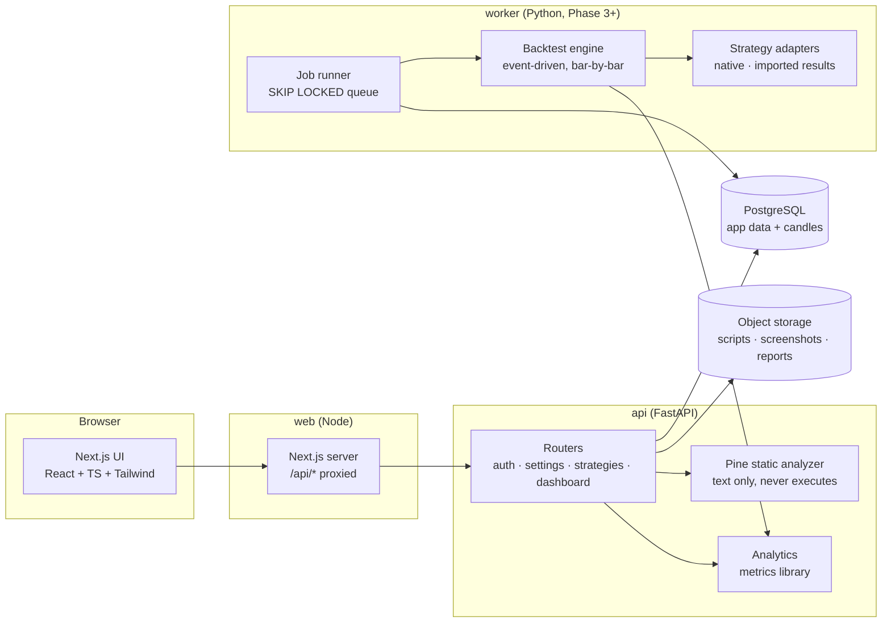

# XAU Lab — Architecture

A research and journaling system for XAUUSD. This document is the brief architecture review the
project starts from. It records decisions, the reasons for them, and the assumptions that still
need verification. Results produced by the system are **historical or simulated** unless labelled
as actual journal trades; nothing here predicts or guarantees future profitability.

## 1. Environment found at start

| Item | Found | Consequence |
|---|---|---|
| Repository | Empty | Greenfield; stack chosen from the brief's preferences |
| Python | 3.13 + `uv` | Backend managed with `uv`, lockfile committed |
| Node | 22 + pnpm 10 | Frontend with Next.js 15 (App Router) |
| PostgreSQL | 16 server binaries | Primary database; used for local dev and the migration check |
| Redis | 7 | Available, but not required in Phase 1 (see §5) |
| Docker | CLI only, no daemon | `docker-compose.yml` is provided but was not exercised here |

## 2. System diagram



* **One API process, one worker process.** Expensive work never runs in a request handler. The
  worker polls a `backtest_jobs` table with `SELECT … FOR UPDATE SKIP LOCKED`, which gives durable,
  cancellable, resumable jobs without adding a broker. Redis/Celery can replace it later behind the
  same `JobQueue` interface if throughput requires it.
* **Pine Script is data.** Uploaded scripts are stored byte-for-byte and analyzed by a static
  scanner. No uploaded code is ever executed on the API server.

## 3. Pine Script compatibility strategy

There is **no documented TradingView API for running a Pine strategy and retrieving its results**.
TradingView's Charting Library and Lightweight Charts are rendering libraries; neither executes
Pine. The design does not assume any private endpoint.

Execution adapters, in the brief's order of preference, with what is actually achievable:

| # | Adapter | Status | Notes |
|---|---|---|---|
| 1 | TradingView Strategy Tester | **Results import only** | The documented workflow is running the script in TradingView and exporting *List of Trades* (CSV). We import that export and attach it to the strategy version + a declared dataset. This is the reference result for parity checks. |
| 2 | Third-party Pine runtime (e.g. open-source PineTS-style interpreters) | **Unverified — research item** | Compatibility, licensing and sandboxing must be proven with parity tests before use. Would run inside the worker in an isolated sandbox, never the API. |
| 3 | Native translation | **Primary execution path** | A strategy is re-expressed as a typed Python strategy (`StrategyAdapter`) that references a specific `StrategyVersion`. Each translation must pass parity tests against an adapter-1 export over the same data. Translation is explicit and reviewed; nothing is auto-rewritten. |
| 4 | Manual/external results | Supported | Any external backtest CSV, labelled with its provenance. |

The **static analyzer** (`backend/app/pine/analyzer.py`) inventories each script: declaration type
(strategy/indicator/library), `//@version`, `strategy()` settings (capital, commission, slippage,
pyramiding, sizing, `process_orders_on_close`, `calc_on_every_tick`…), `input.*` parameters, every
`strategy.*`, `ta.*`, `request.*` call, session/time usage, bar-state usage, and risk patterns
(lookahead, repaint, pivot confirmation delay, `varip`, intrabar assumptions, HTF dependencies).
It then classifies the script:

* **Fully supported and validated** — only possible once a native adapter exists *and* parity tests
  pass. The analyzer alone never assigns this.
* **Partially supported** — every construct is in the engine's supported set, but there is no
  validated adapter yet, or some constructs change semantics (flagged).
* **Requires manual conversion** — uses constructs the engine cannot model directly (custom
  `request.security_lower_tf`, `strategy.order` netting, `varip`…).
* **Cannot currently be executed reliably** — not a strategy (indicator/library), unparseable, or
  depends on data the system cannot reproduce (e.g. `request.financial`, `request.economic`, tick
  data with `calc_on_every_tick`).

Every finding cites the line number and explains the consequence.

## 4. Market-data acquisition plan

1. **CSV import first** (Phase 3): broker/MT5 exports, Dukascopy exports, TradingView exports.
   Each import becomes an immutable `Dataset` version with checksum, provider, symbol, timezone,
   price precision, coverage, and licensing note.
2. **Provider adapters** behind `MarketDataProvider` (fetch → normalize → validate → store). Candidates
   to evaluate, all requiring licence review before automated use: OANDA v20 (account required),
   Dukascopy historical feed (redistribution restrictions), Twelve Data, Polygon (metals coverage
   to confirm). None is wired in until its terms are checked.
3. **Validation**: monotonic UTC timestamps, OHLC consistency (`low ≤ open,close ≤ high`), duplicate
   bars, gaps vs. the expected session calendar (weekend and daily maintenance breaks are expected
   gaps, not missing data), spike/outlier detection against rolling ATR. Problems are reported,
   never silently fixed. Missing candles are never fabricated.
4. **Feeds are not merged.** Two providers' XAUUSD are different datasets; reports name the dataset.

## 5. Data model (relational)

Phase 1 creates the tables marked ●; the rest are specified now and arrive with their phase.

```
User ●                     1─* TradingAccount ●          (kind: demo|live|simulation|prop_eval)
ApplicationSettings ●      1─1 User                      (timezone, base currency, theme…)
Instrument ●               (symbol, tick size, contract size, quote ccy)
BrokerProfile ●            *─1 Instrument                (contract size, min lot, spread model, commission, swap, session hours)
AuditLog ●                 *─1 User                      (sensitive actions)

Strategy ●                 1─* StrategyVersion ●         (immutable; source text, sha256, pine version, kind)
StrategyVersion ●          1─* StrategyInput ●           (name, type, default, options, line)
StrategyVersion ●          1─1 StrategyCompatibilityReport ● (classification, findings JSON, analyzer version)
Strategy ●                 *─* tags (JSON array in Phase 1)

MarketDataProvider         1─* Dataset                   (immutable version, checksum, coverage, tz, licence)
Dataset                    1─* Candle                    (dataset_id, ts_utc, o,h,l,c,v)  — partitioned by dataset/timeframe
BacktestConfiguration      (strategy_version, dataset, timeframe, params JSON, costs JSON, engine_version, config_hash)
BacktestJob                *─1 BacktestConfiguration     (status, progress, error, attempts, cancel_requested)
BacktestResult             1─1 BacktestJob               (metrics JSON, equity curve ref, warnings)
BacktestTrade              *─1 BacktestResult            (entries/exits, fill reasons, ambiguity flag)
PerformanceMetric          (owner ref, scope, name, value, sample size)
ResearchExperiment         1─* BacktestConfiguration     (pipeline stage, IS/OOS windows, scoring model)

JournalTrade ●             *─1 TradingAccount, Instrument, Strategy? (planned stop/target, review fields)
TradeExecution ●           *─1 JournalTrade              (entry|exit|scale_in|scale_out, qty, price, fees, ts_utc)
TradeAttachment            *─1 JournalTrade              (object key, kind: entry|exit|other)
TradeTag ●                 *─* JournalTrade
EconomicEvent              (ts_utc, source, impact, retrieved_at)
SavedReport                (backtest/experiment ref, format, object key, reproducibility hash)
```

Key rules:
* **All timestamps are stored in UTC** (`timestamptz`) and rendered in the user's configured zone.
* **Journal trades are built from executions**, so partial exits, scale-ins and moving stops need
  no special cases. Realized P&L and R are derived from executions, not typed in.
* **Strategy versions are immutable.** Editing = new version. Cloning = new strategy whose first
  version records `cloned_from_version_id`.
* **Backtests reference datasets; they never copy candles.** A `config_hash` over
  (strategy version sha, dataset checksum, timeframe, params, costs, engine version) is the cache
  key and the reproducibility key.

## 6. Phased plan

| Phase | Scope | State |
|---|---|---|
| 1 Foundation | Repo, FastAPI + SQLAlchemy + Alembic, auth, settings, accounts, design system, navigation, overview computed from stored data, empty states | **this commit** |
| 2 Strategy library | Single/batch/ZIP import, duplicate detection, immutable versions, analyzer + compatibility report, source viewer, export, clone, version diff | **analyzer, import, viewer, export in this commit**; diff + clone UI next |
| 3 Data + engine | CSV candles, dataset validation, event-driven engine, costs, first end-to-end XAUUSD backtest, deterministic tests | next |
| 4 Research | Job queue, batch runs, leaderboard, timeframe/session breakdowns, caching, cancellation | |
| 5 Journal | Execution-based trades, CSV import with dedupe, screenshots, reviews, calendar, plan vs actual | |
| 6 Robustness | OOS, walk-forward, sensitivity, cost stress, Monte Carlo, reproducible reports, exports | |
| 7 Advanced | Replay, news calendar, regimes, portfolio sims, more providers, deployment hardening | |

## 7. Highest-risk assumptions (need verification)

1. **Pine parity.** Native translations can drift from TradingView's fill model (bar magnifier,
   `process_orders_on_close`, order-of-fill heuristics inside a bar). Mitigation: parity tests
   against Strategy Tester exports on the same feed; discrepancies are reported, not tuned away.
2. **Feed mismatch.** TradingView's XAUUSD (e.g. OANDA, FOREXCOM, TVC) differs from broker feeds.
   Parity tests are only meaningful on the same feed; the dataset is named in every result.
3. **Data licensing.** Free historical sources often forbid redistribution or automated download.
   Each provider adapter needs a licence check before it is enabled.
4. **Charting.** Lightweight Charts (Apache-2.0, attribution required) covers candles, markers and
   price lines, but has no built-in drawing tools or replay; replay will be implemented by feeding
   bars incrementally, and screenshot annotation needs a separate canvas layer.
5. **Third-party Pine interpreters.** Coverage of Pine v5/v6 semantics (series, `var`, history
   referencing, `request.security` merging) is unknown until tested.
6. **Batch scale.** 100 strategies × 7 timeframes × sessions × windows is thousands of runs; the
   staged pipeline (compatibility → data coverage → baseline → costs → robustness) prunes early.

## 8. Security

* Argon2id password hashing; session JWT in an `HttpOnly`, `SameSite=Lax` cookie; every route
  except `/health` and `/auth/login` requires a user, and every query is scoped by `user_id`.
* Secrets come from environment variables only (`.env.example` lists them; nothing is committed).
* Uploads: extension allow-list (`.pine`, `.txt`, `.zip`), size caps, UTF-8 decoding with a clear
  error, ZIP member count/size/ratio limits, path-traversal rejection, nested archives rejected.
* Audit log entries for login, imports, deletions and exports.
* Login attempts are rate limited per IP (in-process in Phase 1; Redis-backed when multi-process).
